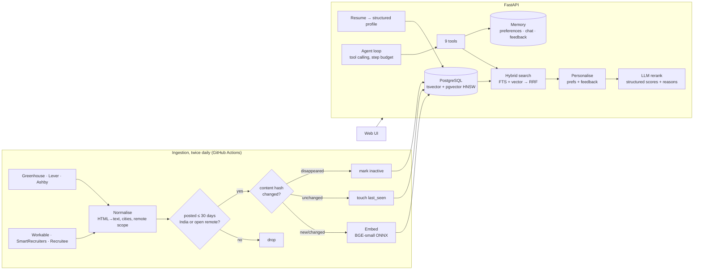

<div align="center">

# Career Agent

**An AI job-search agent over live job postings: hybrid semantic search, personalised recommendations and a tool-using assistant that remembers your preferences.**

Python · FastAPI · PostgreSQL + pgvector · Gemini (tool calling + structured outputs) · Docker

<p>
  
  
  
  
  
  
</p>

<!-- After deploying, replace the # with your live URL -->
[**Live Demo**](#) · [**API docs**](#api) · [**Evaluation**](evals/README.md)

</div>

---

## Overview

Career Agent pulls thousands of real job postings twice a day from the public Greenhouse, Lever, Ashby, Workable,
SmartRecruiters and Recruitee job-board APIs, keeps only the **last 30 days** (shown: the last 14 by default), indexes
them for keyword **and** semantic search, and matches them against a candidate's resume.

- Upload a resume. An LLM reads the PDF itself (layout-aware, works on scanned resumes) and turns it into a
  **validated, structured profile** (JSON-schema constrained output) that you can correct in the UI.
- Get a **personalised feed** built from hybrid retrieval, preference boosts and an LLM reranker that explains each match.
- Chat with an **agent** that calls tools to search, explain fit, save or hide jobs, draft application answers and
  **remember preferences** ("only Bengaluru from now on") across sessions.
- Filter by **city** (Bengaluru, Hyderabad, Pune, Delhi NCR, Mumbai, Chennai, ...) and by **how recent** a posting is
  (this week / last two weeks / last 30 days).
- **Measure it**: retrieval metrics (nDCG@10, Recall@20, MRR) across methods, plus an agent tool-selection eval.

> No scraping: every source is an official, unauthenticated public job-board API.

## Architecture



## How it works

### 1. Incremental ingestion ([app/ingest/](app/ingest/))
- Company boards across six ATS providers ([boards.json](app/ingest/boards.json); add one line to add a company).
  [scripts/discover_boards.py](scripts/discover_boards.py) finds the official board for each company in
  [data/companies.csv](data/companies.csv) (careers-page links first, then slug guesses, verified through the same
  fetchers) and writes candidates for review. It never edits boards.json itself.
- Each source has its own normaliser. Real-world quirks handled: Greenhouse returns HTML-*escaped* HTML; Lever often
  leaves `descriptionPlain` empty and puts the posting in `lists`; Ashby has unlisted postings; Workable lists a job
  once per location under the same shortcode; SmartRecruiters needs a second call per posting for the description.
- **Cities:** one table ([cities.py](app/ingest/cities.py)) maps aliases to canonical names (Bangalore → Bengaluru,
  Gurgaon → Gurugram) and tags regions (Gurugram/Noida/Delhi → **Delhi NCR**). India detection uses word boundaries,
  so "Indianapolis, Indiana" isn't tagged as India.
- **Remote scope:** remote roles are tagged `india` / `global` / `unspecified` / `restricted`; roles limited to other
  countries ("Remote - US") are dropped.
- **Posted date:** the ATS publish date, never an "updated" date (an edit would make an old job look new). Without one,
  the date is when we first saw the job, but only if the board was already being ingested; on a board's first
  ingest that date says nothing, so the job is marked *undated* and hidden by default. Postings older than 30 days
  are not stored, and stored ones expire past 30 days.
- **Change detection:** each posting gets a SHA-256 over the fields that affect search. Unchanged postings are only
  touched; changed ones lose their embedding and are re-embedded; postings that vanished are marked inactive.
  A board that fails to fetch is skipped, so a network error never mass-expires a company's jobs. Seven failed runs
  in a row disable a board (`boards` table, listed in `/api/stats`). Inactive jobs unseen for 60 days are deleted,
  except ones a user saved or dismissed.
- Requests are limited to 4 in flight per ATS host, with `Retry-After` backoff on 429/503.
- **Structure from text** ([extract.py](app/ingest/extract.py)): postings are split into sections by their headings.
  Role, responsibilities and requirements come first and company pitch, benefits and legal text are dropped: the median
  posting is ~6,000 characters and often opens with "About <company>", while the embedder reads ~2,000 and the reranker
  800. From the same sections: **years of experience required** ("5+ years of experience", found in ~2/3 of postings;
  nice-to-have sections and "4-year degree" don't count) and **skill tags** from a fixed vocabulary, with context rules
  for ambiguous words ("Go-to-Market" isn't Go, "the rest of the team" isn't REST).
- Embeddings run **locally** (BGE-small via ONNX/fastembed): no per-call API cost and deterministic for evals.
  `EMBED_VERSION` bumps when the embedded text changes, and the next ingest re-embeds every job made with an older one.

### 2. Retrieval and ranking ([app/search.py](app/search.py))
| Stage | Implementation |
|---|---|
| Keyword | Postgres `tsvector` (title weighted A, company/team B, body C), **OR**-query + `ts_rank_cd` |
| Semantic | pgvector cosine distance on an HNSW index, `ef_search` widened when filters are applied |
| Early-career source | For intern/entry profiles, a third retriever: vector search limited to intern/new-grad/associate titles. Without it these roles (<1% of the index) get crowded out |
| Fusion | Weighted Reciprocal Rank Fusion, `k = 60`: vector 1.0, keyword 0.3, early-career 0.5 (tuned on the eval labels) |
| Query parsing | "remote backend jobs in pune" → query "backend" + Pune + remote ([app/query.py](app/query.py)). City names stay out of the keyword query, where they'd match every posting in that city |
| Filters | City (array overlap on canonical names), India, remote, and a posting window (default 14 days). One filter bar drives both the feed and search |
| Personalisation | Boosts for preferred cities/roles/remote; dismissed jobs and avoided companies filtered out |
| Freshness | ×1.05 for postings under 3 days old; *Newest* sort orders by date instead (and skips the rerank) |
| Dedupe | One card per company + title (city suffix ignored) + cities |
| Seniority fit | Title level (intern → staff/manager) vs the profile's level; a student's feed isn't led by Staff roles |
| Experience fit | Years the posting requires vs the profile's years (1 year of slack): ×0.85 at +2, ×0.65 at +4, ×0.45 beyond. Combined with seniority fit, floored at ×0.2 |
| Skill overlap | Up to ×1.2 when the posting's skill tags match the profile's (or the query's) skills. Only a boost: tags come from a fixed vocabulary |
| Learns from feedback | The feed's profile vector moves toward the mean of your last 30 saved jobs (0.5) and away from dismissed ones (0.15), Rocchio-style |
| Rerank | LLM grades the top 24 (0–10) with a one-line reason, via structured output, in two parallel batches of 12 interleaved by rank so the grades stay comparable. It reads the role and requirement sections and the years required. Ties keep retrieval order; hallucinated ids are ignored |

Why an OR-query: `websearch_to_tsquery` ANDs every term, so a profile-length query matches almost nothing.
OR keeps recall high, and `ts_rank_cd` still rewards postings that match more terms.

### 3. The agent ([app/agent/](app/agent/))
A hand-written tool-calling loop (no framework) so every step is visible:

1. Model step with 9 tool declarations (JSON Schema generated from Pydantic models).
2. Each tool call is **validated** against its Pydantic model. Bad arguments, unknown ids or a missing resume come back
   to the model as `{"error": ...}` so it can correct itself rather than crash.
3. Results are fed back; repeat until a text answer or a **6-step budget**, then one forced no-tools answer.
4. Every step is traced (`tool`, `args`, `ok`, `ms`) and shown under each reply in the UI.

| Tool | Purpose |
|---|---|
| `search_jobs` | Hybrid search with location / India / remote / company filters |
| `recommend_jobs` | Profile-seeded feed with LLM rerank |
| `get_job_details` | Full posting text |
| `explain_match` | Structured matching vs missing skills + verdict |
| `save_job` / `dismiss_job` / `list_saved_jobs` | Feedback that changes future rankings |
| `update_preferences` | Long-term memory (merge semantics) |
| `draft_application_answer` | Grounded draft using only profile facts |

**Memory:** short-term = the last 12 chat messages; long-term = structured preferences in Postgres that the agent
writes via `update_preferences` and the ranker reads. Gemini's raw response objects are replayed within a turn so
thought signatures on function calls are preserved.

**Cost control:** a per-user daily cap on LLM calls (atomic upsert counter); every agent step and rerank is counted.
Runs on the Gemini **free tier** (`gemini-3.1-flash-lite`). 429/503 responses are retried with exponential backoff
(3 → 24 s), because the larger flash models regularly return 503 "high demand" on free keys.

### 4. Evaluation ([evals/](evals/README.md))
- **Retrieval:** frozen snapshot of the index in its own database → 20 queries → pooled labels (top-20 from each
  method) graded 0–3 by an LLM judge → nDCG@10 / Recall@20 / MRR / latency per method.
- **Agent:** 15 messages with the expected first tool and argument subset → tool and argument accuracy.

## Results

Retrieval on a frozen snapshot of **2,783 live jobs**, 20 queries, 957 pooled judgements graded by
`gemini-3.5-flash-lite` (the app itself uses `gemini-3.1-flash-lite`, so the reranker isn't grading itself).
Raw output: [evals/results/retrieval.json](evals/results/retrieval.json), labels: [evals/data/qrels.json](evals/data/qrels.json).

| Method | nDCG@10 | Recall@20 | MRR | p50 ms | p95 ms |
|---|---|---|---|---|---|
| keyword (Postgres FTS) | 0.436 | 0.550 | 0.595 | 29 | 98 |
| vector (pgvector) | 0.666 | 0.715 | 0.754 | 29 | 35 |
| **hybrid (weighted RRF)** | **0.678** | **0.763** | **0.762** | 49 | 114 |
| hybrid + LLM rerank | not re-measured yet (Gemini returned 503s); was 0.795 on the first 736 labels | | | ~4700 | ~7800 |

**What this says:**
- **Weighted RRF fixed hybrid.** With equal weights hybrid scored 0.640 on these labels, below vector-only; with
  keyword at 0.3 and early-career at 0.5 it is now the best retrieval method on nDCG@10 and Recall@20.
- Embedding the role and requirement sections instead of the whole posting (EMBED_VERSION 2) raised hybrid Recall@20
  from 0.723 to 0.763; nDCG@10 is flat (0.675 → 0.678) and MRR slightly lower (0.792 → 0.762).
- The labels were extended twice (`label --extend`) as new rankings surfaced unjudged jobs, so these numbers
  aren't comparable with the first table's 736-label run.
- Caveats: LLM-judged pooled labels, no human spot-check yet (`human_checked: 0`), 20 queries.
  Re-run `python -m evals.run_retrieval` for the rerank row.

Agent tool-selection eval ([evals/agent_cases.json](evals/agent_cases.json), 15 cases): not run yet. Run
`python -m evals.run_agent` and add the result here.

## Getting started

### Prerequisites
- Docker Desktop
- A free Gemini API key from [Google AI Studio](https://aistudio.google.com/apikey) (optional: `LLM_PROVIDER=fake` runs
  everything offline with deterministic heuristics)

### Run locally
```bash
git clone https://github.com/MohitAnuragi/CareerAgent.git
cd CareerAgent
cp .env.example .env              # add GEMINI_API_KEY
docker compose up -d db
docker compose run --rm ingest    # first run embeds everything (~10–20 min on a laptop); later runs only changes
docker compose up api             # http://localhost:8000
```

### Tests
```bash
docker compose run --rm api python -m pytest -q
```
66 tests: normalisers, text extraction, ranking maths, metrics and the agent loop run without a DB; integration tests use a real
Postgres + pgvector (`career_agent_test`) and the real embedding model.

> **Windows note:** if Smart App Control blocks psycopg's bundled `libpq` DLL, run everything through Docker as above.

## Deployment

| Piece | Free option |
|---|---|
| Postgres + pgvector | [Supabase](https://supabase.com) or [Neon](https://neon.tech) (both ship pgvector) |
| API + UI | [Vercel](https://vercel.com) (FastAPI preset; `pyproject.toml` sets the entrypoint), or [Render](https://render.com) from the `Dockerfile` |
| Nightly ingest | [.github/workflows/ingest.yml](.github/workflows/ingest.yml) with a `DATABASE_URL` repo secret |

1. **Database:** create a Supabase project and copy the **pooler** connection string (Connect → Session or
   Transaction pooler). The direct host is IPv6-only and can't be reached from Vercel or GitHub Actions.
2. **Index:** add that URL as the `DATABASE_URL` repository secret, then run *Actions → Nightly ingest → Run workflow*
   once. It creates the schema and loads the jobs.
3. **API:** import the repo on Vercel with the FastAPI preset and set these environment variables:

| Variable | Value |
|---|---|
| `DATABASE_URL` | the same pooler URL |
| `GEMINI_API_KEY` | your key |
| `LLM_PROVIDER` | `gemini` |
| `GEMINI_MODEL` | `gemini-3.1-flash-lite` |
| `FASTEMBED_CACHE` | `/tmp/fastembed` (the only writable path on Vercel; the model downloads there on a cold start) |
| `DB_POOL_MAX` | `3` |
| `DAILY_LLM_LIMIT` | `40` (per user) |
| `GLOBAL_DAILY_LLM_LIMIT` | `800` (all users combined; protects the free-tier quota) |
| `FRESH_DAYS_DEFAULT` | `14` (optional; posting window when the user hasn't picked one) |

Ingestion runs in GitHub Actions, not on Vercel: functions stop after 60 s, and a full first ingest takes several minutes.

## API

Interactive docs at `/docs`. Send `X-User-Id` (from `POST /api/users`) on user-scoped routes.

| Method | Route | Purpose |
|---|---|---|
| `POST` | `/api/users` | Create an anonymous user |
| `POST` | `/api/profile` | Upload resume (PDF `file` or `text`) → structured profile |
| `GET` | `/api/recommendations` | Personalised feed (`rerank=true` by default); same filters as search (`cities`, `india_only`, `remote_only`, `posted_within_days`) |
| `GET` | `/api/search` | `q`, `method=keyword\|vector\|hybrid\|hybrid_rerank`, `india_only`, `remote_only`, `cities`, `sort`. Cities and "remote" written in `q` become filters; the response's `understood` says what was read (`parse=false` turns this off) |
| `POST` | `/api/feedback` | `{job_id, action: save\|dismiss\|clear, reason?}`; dismiss reason `company` adds the company to `avoid_companies` |
| `GET` | `/api/saved` | Saved jobs, each with its application `status` |
| `PUT` | `/api/saved/{job_id}` | `{status: saved\|applied\|interviewing\|offer\|rejected}` (the Saved tab's tracker) |
| `POST` | `/api/chat` | Agent turn → `{reply, trace, jobs, preferences}` |
| `PUT` | `/api/profile` | Save a corrected profile (skills, roles, level); re-embeds it, no LLM call |
| `PUT` | `/api/preferences` | Edit long-term memory directly |
| `GET` | `/api/stats` | Index size and last ingest run |
| `POST` | `/admin/ingest` | Trigger ingestion (`Authorization: Bearer $ADMIN_TOKEN`) |

## Project structure

```
CareerAgent/
├── app/
│   ├── api.py              # FastAPI routes, error mapping, static UI
│   ├── config.py           # pydantic-settings
│   ├── db.py / schema.sql  # pool, tsvector + pgvector schema
│   ├── models.py           # Pydantic models: Job, CandidateProfile, Preferences, rerank/match schemas
│   ├── embeddings.py       # local BGE embeddings
│   ├── search.py           # keyword, vector, RRF, personalisation, rerank, recommend
│   ├── profile.py          # PDF → text → structured profile
│   ├── store.py            # users, memory, feedback, usage caps
│   ├── llm/                # provider-neutral interface, Gemini, offline + scripted fakes
│   ├── agent/              # tools (validated) + loop (step budget, trace)
│   ├── ingest/             # sources, normalisers, cities, incremental pipeline, boards.json
│   └── static/             # web UI (vanilla JS)
├── data/companies.csv      # companies to run board discovery on
├── scripts/                # discover_boards.py, fetch_model.py
├── evals/                  # snapshot, LLM-judge labels, retrieval + agent evals
├── tests/                  # unit + Postgres integration tests
├── Dockerfile · docker-compose.yml
└── .github/workflows/      # CI + twice-daily ingest
```

## Design decisions and limitations
- **Local embeddings over an embedding API:** zero marginal cost and reproducible evals. The trade-off is a slower
  first ingest on small machines.
- **Anonymous users** (an id in `localStorage`) keep the demo frictionless. Real auth is a roadmap item.
- **The raw resume is never stored**, only the extracted profile.
- **Prompt injection:** job descriptions are untrusted third-party text that reaches the LLM. They are wrapped in
  delimiters, and the agent's tools are deliberately low-privilege: they can only read jobs and change the
  current user's own saved jobs and preferences. So a malicious posting can at worst skew one user's answer.
- Eval labels are LLM-judged and pooled. The numbers are relative comparisons between methods, not absolute truth;
  see the caveats in [evals/README.md](evals/README.md).

## Roadmap
- Learning-to-rank from save/dismiss feedback once there's enough interaction data
- Job alerts (email/WhatsApp) for new postings matching the profile
- Streaming agent responses
- Google sign-in

## License

Released under the **MIT License**. See [`LICENSE`](LICENSE).

## Author

**Mohit Anuragi** · [GitHub](https://github.com/MohitAnuragi)

---

<sub>Job data comes from each company's public job board via the Greenhouse, Lever, Ashby, Workable, SmartRecruiters and Recruitee posting APIs. Always apply through the original posting.</sub>
