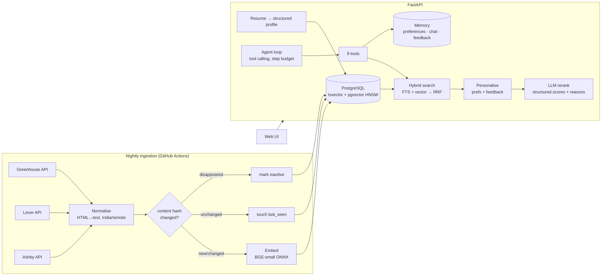

<div align="center">

# Career Agent

**An AI job-search agent over live job postings: hybrid semantic search, personalised recommendations and a tool-using assistant that remembers your preferences.**

Python · FastAPI · PostgreSQL + pgvector · Gemini (tool calling + structured outputs) · Docker

<p>
  
  
  
  
  
  
</p>

<!-- After deploying, replace the # with your live URL -->
[**Live Demo**](#) · [**API docs**](#api) · [**Evaluation**](evals/README.md)

</div>

---

## Overview

Career Agent pulls thousands of real job postings every night from the public Greenhouse, Lever and Ashby job-board
APIs, indexes them for keyword **and** semantic search, and matches them against a candidate's resume.

- Upload a resume. An LLM turns it into a **validated, structured profile** (JSON-schema constrained output).
- Get a **personalised feed** built from hybrid retrieval, preference boosts and an LLM reranker that explains each match.
- Chat with an **agent** that calls tools to search, explain fit, save or hide jobs, draft application answers and
  **remember preferences** ("only Bengaluru from now on") across sessions.
- **Measure it**: retrieval metrics (nDCG@10, Recall@20, MRR) across methods, plus an agent tool-selection eval.

> No scraping: every source is an official, unauthenticated public job-board API.

## Architecture



## How it works

### 1. Incremental ingestion ([app/ingest/](app/ingest/))
- 33 company boards across three ATS providers ([boards.json](app/ingest/boards.json); add one line to add a company).
- Each source has its own normaliser. Real-world quirks handled: Greenhouse returns HTML-*escaped* HTML; Lever often
  leaves `descriptionPlain` empty and puts the posting in `lists`; Ashby has unlisted postings. India detection uses
  word boundaries so "Indianapolis, Indiana" isn't tagged as India.
- **Change detection:** each posting gets a SHA-256 over the fields that affect search. Unchanged postings are only
  touched; changed ones lose their embedding and are re-embedded; postings that vanished are marked inactive.
  A board that fails to fetch is skipped, so a network error never mass-expires a company's jobs.
- Embeddings run **locally** (BGE-small via ONNX/fastembed): no per-call API cost and deterministic for evals.

### 2. Retrieval and ranking ([app/search.py](app/search.py))
| Stage | Implementation |
|---|---|
| Keyword | Postgres `tsvector` (title weighted A, company/team B, body C), **OR**-query + `ts_rank_cd` |
| Semantic | pgvector cosine distance on an HNSW index, `ef_search` widened when filters are applied |
| Early-career source | For intern/entry profiles, a third retriever: vector search limited to intern/new-grad/associate titles. Without it these roles (<1% of the index) get crowded out |
| Fusion | Reciprocal Rank Fusion, `k = 60`, over all candidate lists |
| Personalisation | Boosts for preferred cities/roles/remote; dismissed jobs and avoided companies filtered out |
| Seniority fit | Title level (intern → staff/manager) vs the profile's level; a student's feed isn't led by Staff roles |
| Rerank | LLM grades the top 15 (0–10) with a one-line reason, via structured output; hallucinated ids are ignored |

Why an OR-query: `websearch_to_tsquery` ANDs every term, so a profile-length query matches almost nothing.
OR keeps recall high, and `ts_rank_cd` still rewards postings that match more terms.

### 3. The agent ([app/agent/](app/agent/))
A hand-written tool-calling loop (no framework) so every step is visible:

1. Model step with 9 tool declarations (JSON Schema generated from Pydantic models).
2. Each tool call is **validated** against its Pydantic model. Bad arguments, unknown ids or a missing resume come back
   to the model as `{"error": ...}` so it can correct itself rather than crash.
3. Results are fed back; repeat until a text answer or a **6-step budget**, then one forced no-tools answer.
4. Every step is traced (`tool`, `args`, `ok`, `ms`) and shown under each reply in the UI.

| Tool | Purpose |
|---|---|
| `search_jobs` | Hybrid search with location / India / remote / company filters |
| `recommend_jobs` | Profile-seeded feed with LLM rerank |
| `get_job_details` | Full posting text |
| `explain_match` | Structured matching vs missing skills + verdict |
| `save_job` / `dismiss_job` / `list_saved_jobs` | Feedback that changes future rankings |
| `update_preferences` | Long-term memory (merge semantics) |
| `draft_application_answer` | Grounded draft using only profile facts |

**Memory:** short-term = the last 12 chat messages; long-term = structured preferences in Postgres that the agent
writes via `update_preferences` and the ranker reads. Gemini's raw response objects are replayed within a turn so
thought signatures on function calls are preserved.

**Cost control:** a per-user daily cap on LLM calls (atomic upsert counter); every agent step and rerank is counted.
Runs on the Gemini **free tier** (`gemini-3.1-flash-lite`). 429/503 responses are retried with exponential backoff
(3 → 24 s), because the larger flash models regularly return 503 "high demand" on free keys.

### 4. Evaluation ([evals/](evals/README.md))
- **Retrieval:** frozen snapshot of the index in its own database → 20 queries → pooled labels (top-20 from each
  method) graded 0–3 by an LLM judge → nDCG@10 / Recall@20 / MRR / latency per method.
- **Agent:** 15 messages with the expected first tool and argument subset → tool and argument accuracy.

## Results

Retrieval on a frozen snapshot of **2,783 live jobs**, 20 queries, 736 pooled judgements graded by
`gemini-3.5-flash-lite` (the app itself uses `gemini-3.1-flash-lite`, so the reranker isn't grading itself).
Raw output: [evals/results/retrieval.json](evals/results/retrieval.json), labels: [evals/data/qrels.json](evals/data/qrels.json).

| Method | nDCG@10 | Recall@20 | MRR | p50 ms | p95 ms |
|---|---|---|---|---|---|
| keyword (Postgres FTS) | 0.458 | 0.590 | 0.564 | 27 | 1184 |
| vector (pgvector) | 0.697 | 0.740 | 0.805 | 33 | 86 |
| hybrid (RRF) | 0.622 | 0.734 | 0.725 | 46 | 95 |
| **hybrid + LLM rerank** | **0.795** | 0.734 | **0.882** | 4701 | 7757 |

**What this says:**
- The LLM reranker is the biggest win: **+0.17 nDCG@10 over hybrid and +0.10 over vector-only**, at about 4.7 s per request.
- **Hybrid RRF is *worse* than vector-only here.** Equal-weight RRF lets the much weaker keyword list pull noise into
  the top 10. Next step: a weighted RRF (or keyword only as a recall booster) tuned on these labels.
- Recall@20 is the same for hybrid and hybrid + rerank by construction: the reranker reorders the top 15, it doesn't fetch new jobs.
- Caveats: LLM-judged pooled labels, no human spot-check yet (`human_checked: 0`), 20 queries.

Agent tool-selection eval ([evals/agent_cases.json](evals/agent_cases.json), 15 cases): not run yet. Run
`python -m evals.run_agent` and add the result here.

## Getting started

### Prerequisites
- Docker Desktop
- A free Gemini API key from [Google AI Studio](https://aistudio.google.com/apikey) (optional: `LLM_PROVIDER=fake` runs
  everything offline with deterministic heuristics)

### Run locally
```bash
git clone https://github.com/MohitAnuragi/CareerAgent.git
cd CareerAgent
cp .env.example .env              # add GEMINI_API_KEY
docker compose up -d db
docker compose run --rm ingest    # first run embeds everything (~10–20 min on a laptop); later runs only changes
docker compose up api             # http://localhost:8000
```

### Tests
```bash
docker compose run --rm api python -m pytest -q
```
27 tests: normalisers, ranking maths, metrics and the agent loop run without a DB; integration tests use a real
Postgres + pgvector (`career_agent_test`) and the real embedding model.

> **Windows note:** if Smart App Control blocks psycopg's bundled `libpq` DLL, run everything through Docker as above.

## Deployment

| Piece | Free option |
|---|---|
| Postgres + pgvector | [Supabase](https://supabase.com) or [Neon](https://neon.tech) (both ship pgvector) |
| API + UI | [Render](https://render.com) web service from the `Dockerfile` (reads `$PORT`) |
| Nightly ingest | [.github/workflows/ingest.yml](.github/workflows/ingest.yml) with a `DATABASE_URL` repo secret |

Set `DATABASE_URL`, `GEMINI_API_KEY` and `DAILY_LLM_LIMIT` on the web service. The schema is created on first boot.

## API

Interactive docs at `/docs`. Send `X-User-Id` (from `POST /api/users`) on user-scoped routes.

| Method | Route | Purpose |
|---|---|---|
| `POST` | `/api/users` | Create an anonymous user |
| `POST` | `/api/profile` | Upload resume (PDF `file` or `text`) → structured profile |
| `GET` | `/api/recommendations` | Personalised feed (`rerank=true` by default) |
| `GET` | `/api/search` | `q`, `method=keyword\|vector\|hybrid\|hybrid_rerank`, `india_only`, `remote_only`, `location` |
| `POST` | `/api/feedback` | `{job_id, action: save\|dismiss\|clear}` |
| `GET` | `/api/saved` | Saved jobs |
| `POST` | `/api/chat` | Agent turn → `{reply, trace, jobs, preferences}` |
| `PUT` | `/api/preferences` | Edit long-term memory directly |
| `GET` | `/api/stats` | Index size and last ingest run |
| `POST` | `/admin/ingest` | Trigger ingestion (`Authorization: Bearer $ADMIN_TOKEN`) |

## Project structure

```
CareerAgent/
├── app/
│   ├── api.py              # FastAPI routes, error mapping, static UI
│   ├── config.py           # pydantic-settings
│   ├── db.py / schema.sql  # pool, tsvector + pgvector schema
│   ├── models.py           # Pydantic models: Job, CandidateProfile, Preferences, rerank/match schemas
│   ├── embeddings.py       # local BGE embeddings
│   ├── search.py           # keyword, vector, RRF, personalisation, rerank, recommend
│   ├── profile.py          # PDF → text → structured profile
│   ├── store.py            # users, memory, feedback, usage caps
│   ├── llm/                # provider-neutral interface, Gemini, offline + scripted fakes
│   ├── agent/              # tools (validated) + loop (step budget, trace)
│   ├── ingest/             # sources, normalisers, incremental pipeline, boards.json
│   └── static/             # web UI (vanilla JS)
├── evals/                  # snapshot, LLM-judge labels, retrieval + agent evals
├── tests/                  # unit + Postgres integration tests
├── Dockerfile · docker-compose.yml
└── .github/workflows/      # CI + nightly ingest
```

## Design decisions and limitations
- **Local embeddings over an embedding API:** zero marginal cost and reproducible evals. The trade-off is a slower
  first ingest on small machines.
- **Anonymous users** (an id in `localStorage`) keep the demo frictionless. Real auth is a roadmap item.
- **The raw resume is never stored**, only the extracted profile.
- **Prompt injection:** job descriptions are untrusted third-party text that reaches the LLM. They are wrapped in
  delimiters, and the agent's tools are deliberately low-privilege: they can only read jobs and change the
  current user's own saved jobs and preferences. So a malicious posting can at worst skew one user's answer.
- Eval labels are LLM-judged and pooled. The numbers are relative comparisons between methods, not absolute truth;
  see the caveats in [evals/README.md](evals/README.md).

## Roadmap
- Learning-to-rank from save/dismiss feedback once there's enough interaction data
- Job alerts (email/WhatsApp) for new postings matching the profile
- Streaming agent responses
- Google sign-in

## License

Released under the **MIT License**. See [`LICENSE`](LICENSE).

## Author

**Mohit Anuragi** · [GitHub](https://github.com/MohitAnuragi)

---

<sub>Job data comes from each company's public job board via the Greenhouse, Lever and Ashby posting APIs. Always apply through the original posting.</sub>
